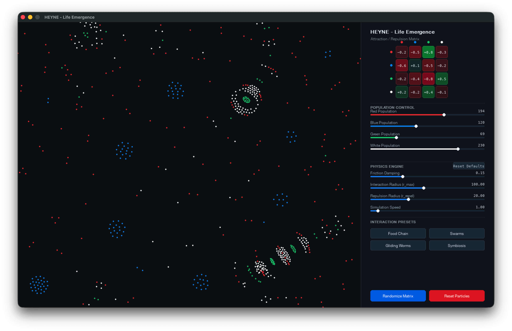

# Life Emergence

Life Emergence is an interactive artificial life simulator written in Python. It explores how simple local interaction rules can give rise to complex collective behavior.



## Overview

The simulation consists of four particle species: **Red**, **Blue**, **Green**, and **White**.

Interactions between species are defined by a 4×4 interaction matrix. Each matrix entry specifies the attraction or repulsion strength that one species experiences toward another.

Interaction weights range from `-1.0` to `+1.0`:

- Negative values represent repulsion.
- Positive values represent attraction.
- Values close to zero result in weak or negligible interaction.

By modifying these interaction parameters, the system can produce a variety of emergent structures and collective behaviors.

## Features

The simulation allows you to interact with the particle system in real time. You can change how the different species attract or repel each other, adjust their population sizes, and modify basic physics parameters such as friction and interaction distance.

Several preset configurations are included to demonstrate different emergent behaviors, and the interaction matrix can also be randomized to explore new patterns.

The simulation is implemented in Python using NumPy for the particle calculations and Pygame for visualization.

## Installation

### Requirements

- Python 3.10 or newer

### 1. Clone the repository

```bash
git clone https://github.com/chrisheyne-eth/life-emergence.git
cd life-emergence
```

### 2. Create a virtual environment

#### macOS / Linux

```bash
python3 -m venv .venv
source .venv/bin/activate
```

#### Windows

```cmd
python -m venv .venv
.venv\Scripts\activate
```

### 3. Install dependencies

```bash
pip install -r requirements.txt
```

## Usage

Start the simulation with:

```bash
python app.py
```

### Controls

- **Left-click** a matrix cell to increase the interaction value by `+0.1`.
- **Right-click** a matrix cell to decrease the interaction value by `-0.1`.
- Use the **Presets** menu to load predefined interaction matrices.
- Select **Randomize Matrix** to generate a new interaction configuration.
- Select **Reset Defaults** to restore the default simulation parameters.

## Model

The behavior of the system is determined by pairwise interactions between particles.

For four species, the interaction matrix contains 16 directed interaction parameters. Because the matrix is not required to be symmetric, species A can respond differently to species B than species B responds to species A.

This simple rule set allows complex structures such as clusters, chains, swarms, and dynamically stable patterns to emerge from local interactions.

## License

Distributed under the MIT License. See `LICENSE` for details.
